# MICROCOSM

A 64 KB demo engine and toolkit for x86_64 Linux, written in C11. It comes
with *Hello World*, a four-and-a-half-minute demo that fits in 63,237 bytes.

[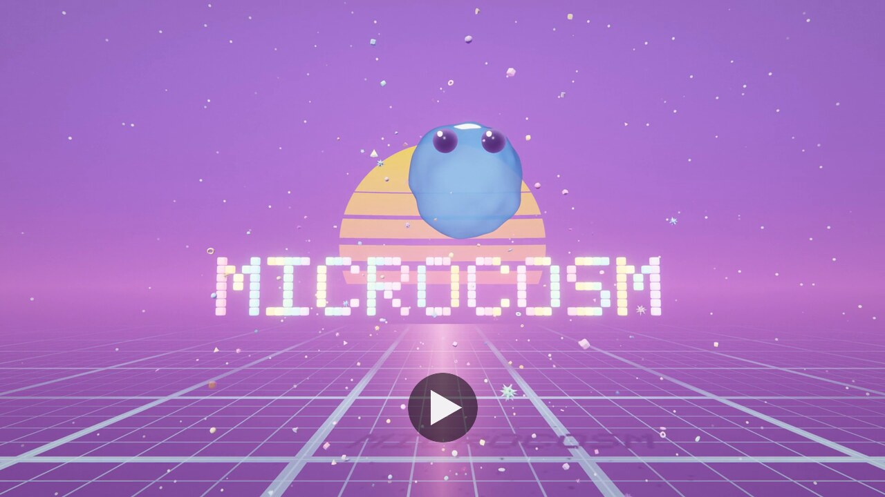](../../releases/latest/download/hello-world-1080p60.mp4)

*Click the picture to watch the whole demo (1920x1080, 60 fps, 4:39, H.264
and AAC, 357 MB). The file is too big to keep in the repository, so it's
attached to the [latest release](../../releases/latest) instead. The demo's
own capture build rendered it offline with `make capture` on a laptop with
Intel UHD 620 integrated graphics and Mesa. Every frame was rendered at
3840×2160 and downsampled to 1920×1080; the sound is its own soundtrack.
Rendering the 16,722-frame master took about 57 minutes, before final encoding.
The video's 60 fps is its playback rate, not a real-time GPU benchmark.*

> [!IMPORTANT]
> **This project was heavily developed with the help of AI.** Always
> double-check the code before you use it or build on it. If you want to enter
> a demo made with MICROCOSM in a competition, check first that the competition
> accepts AI-generated code. Not all of them do.

MICROCOSM is a small, self-contained demoscene engine. It generates its
geometry, renders through an instanced HDR pipeline with a full set of post
effects, and plays music from a software synth that uses no samples. Its build
pipeline compresses the engine, the demo and the soundtrack into one
self-extracting ELF that fits in the classic 64 KB. It needs OpenGL 4.5 core
and runs either in a window, through X11 and EGL, or headless through
surfaceless EGL. The binary doesn't import a single GL symbol.

Everything you see and hear is computed while it runs. There are no texture,
mesh or sample files: code that generates something compresses to almost
nothing, and a texture doesn't.

If you just want a fragment shader on screen in ten lines, skip to
[the ten-line version](#the-ten-line-version-tiny64). For how the whole thing
works, read [the internals tour](docs/architecture.org).

| | | |
|:-:|:-:|:-:|
| 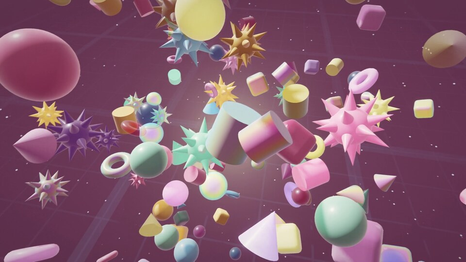 | 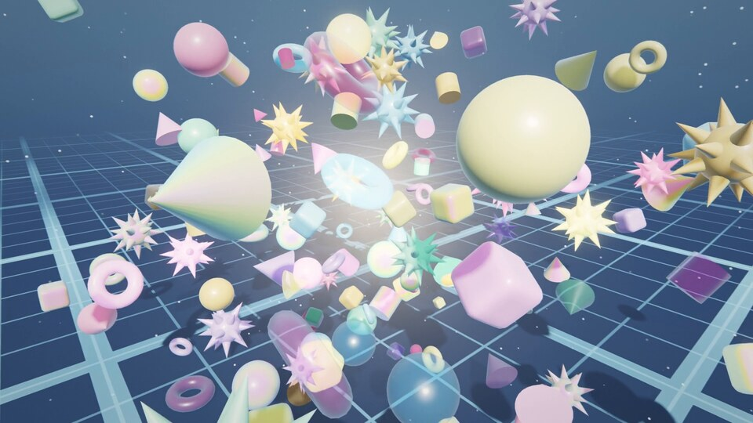 | 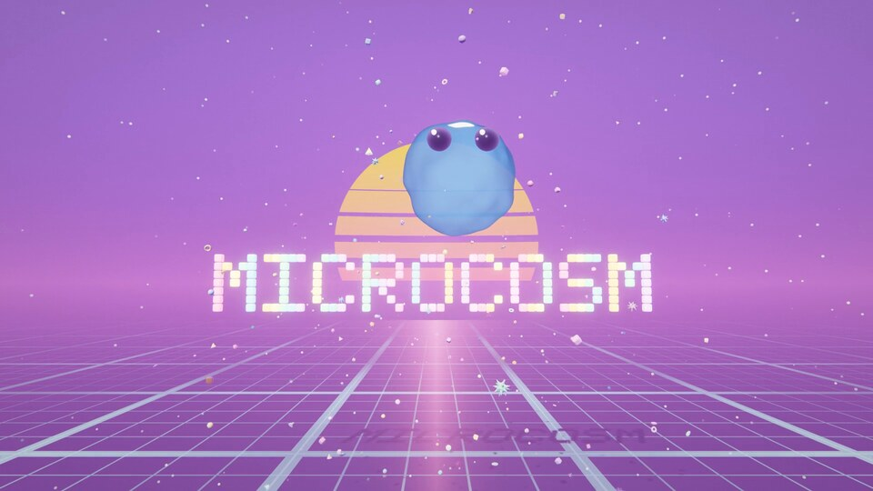 |
| 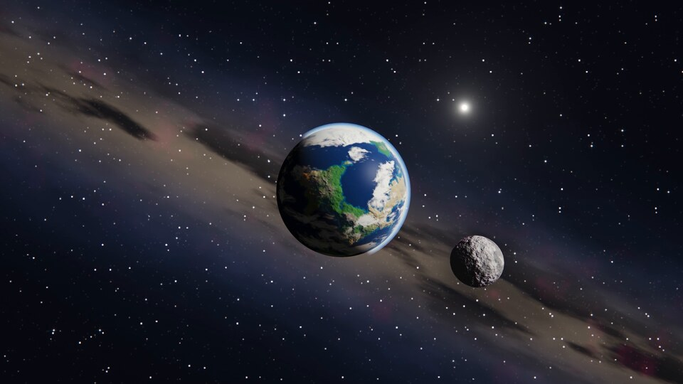 | 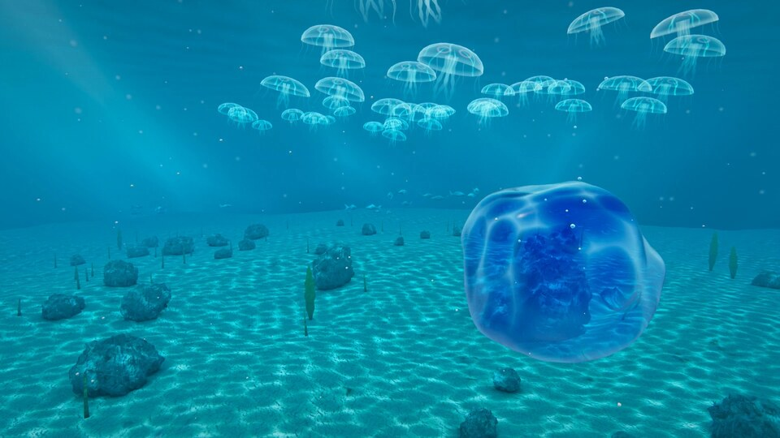 | 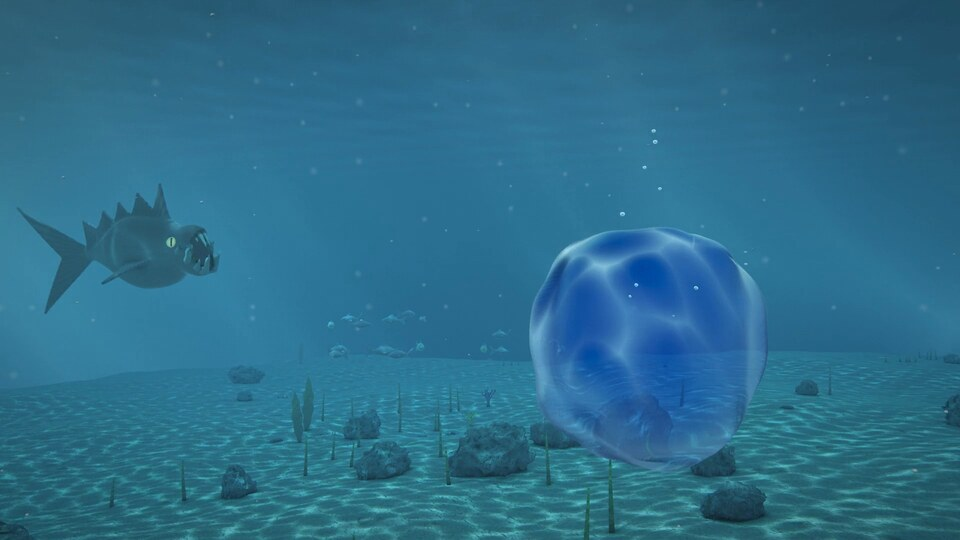 |
| 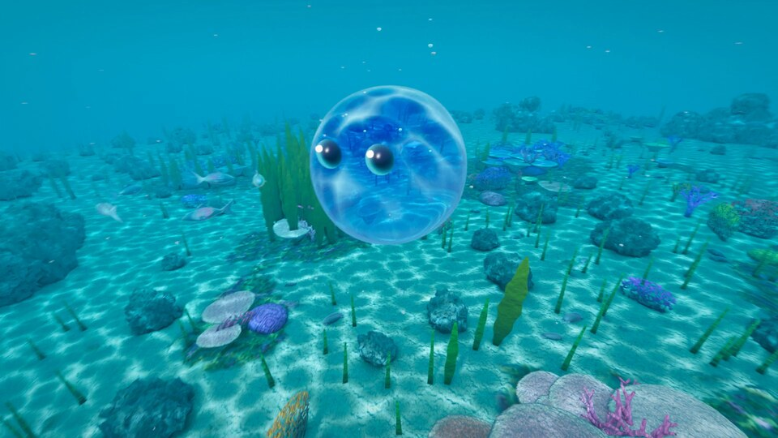 | 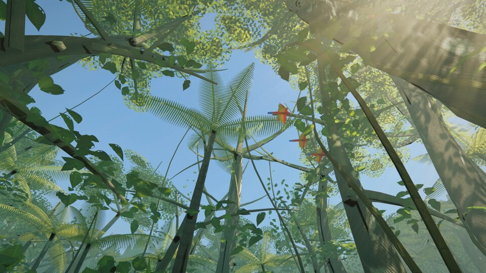 |  |
| 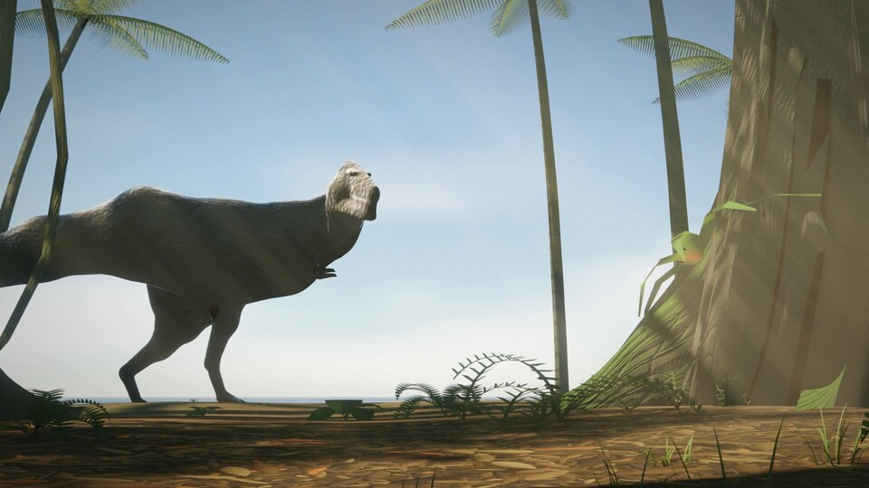 | 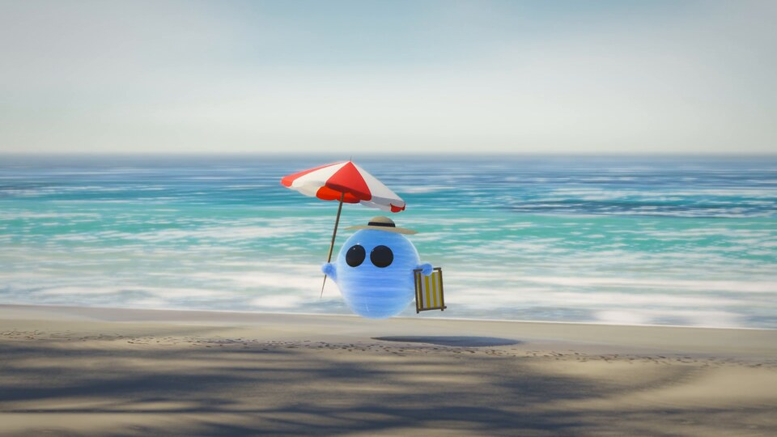 | 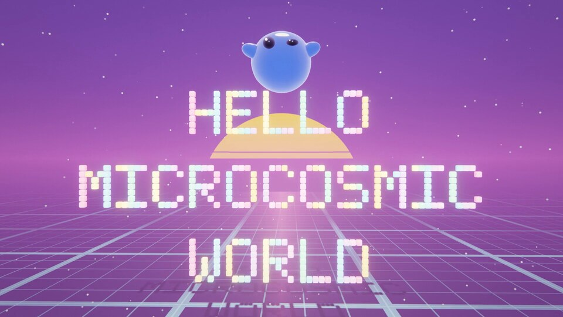 |

## Features

### The engine (`mc_` C API)

- Math: `vec2/3/4`, column-major `mat4`, quaternions, value and gradient
  noise, fBm and curl noise, 11 easing curves, Catmull-Rom and cubic Bézier
  splines, and a small deterministic xorshift PRNG whose state you carry
  yourself.
- GL loader: every OpenGL 4.5 function the engine uses is looked up at
  runtime with `eglGetProcAddress`, so the binary doesn't link `libGL` and
  imports no GL symbols. Compute shaders, storage buffers and sampler objects
  are all available.
- Platform: window, context, input and a monotonic clock, with two backends,
  on-screen X11+EGL or headless surfaceless EGL. Tests can read pixels back and
  save PNG screenshots. Fullscreen takes the screen's size from the first
  frame, with or without a window manager, and hides the pointer.
- Procedural meshes: box, plane, UV sphere, icosphere, torus, cylinder, cone,
  rounded box and an fBm terrain, with subdivide, displace, spherify and scale
  modifiers. Meshes are built on the CPU as indexed triangle lists. You can
  also skip meshes and let a vertex shader build its vertices from
  `gl_VertexID`.
- Renderer: helpers for shaders (including compute) and GPU meshes,
  instancing, RGBA16F HDR targets and a fixed post chain. The chain has
  optional ground-truth ambient occlusion (GTAO) with contact shadows,
  optional depth of field, six levels of bloom, camera motion blur, a filmic
  tonemap, a split-tone grade, chromatic aberration, vignette, fades,
  temporal anti-aliasing (TAA), film grain and a dither. The TAA can upsample
  from a lower internal resolution, and the present pass filters a
  supersampled one (up to 200%) down. If the screen isn't 16:9, the picture is
  letterboxed or pillarboxed. The ambient occlusion only darkens the ambient
  part of the light, which the scene writes into alpha. A caller can also add
  its own low-resolution light, such as volumetric shafts, and the renderer
  gives it a depth-aware blur.
- Baked materials and vertex animation: a render-to-texture baker makes tiled
  sand and rock, sampled triplanar (so there are no UVs) with anisotropic
  filtering. Vertex shaders make fish swim and seaweed sway. Scene 3 bakes its
  bark, leaf and sand tiles the same way at load, plus an atlas of its own
  trees seen from eight sides.
- Scene: camera helpers, keyframe tracks, and beat and timeline helpers for
  syncing the picture to the music.
- Audio: a procedural softsynth with a non-blocking ALSA backend on its own
  thread. Without a sound device it plays silently, still in real time.

### tiny64 (`include/microcosm/tiny64.h`)

A header-only wrapper over the engine for single-shader intros: open a window,
hand it a fragment shader and draw. It's the easiest place to start.

### The toolkit

The build tools include a GLSL minifier (safe and deterministic), a shader
baker, an ELF section-header stripper, a function ordering pass and a size
report. Then there's the packer (`mkelf.sh`, `cm.h`,
`s2dec.S`), an x86-aware context-mixing compressor that searches for the best
model for each payload.

The packer's launcher is hand-written assembly that uses no libraries, and it
comes in two stages. A first stage of a few hundred bytes (`s1dec.S`) writes
the ELF header and unpacks the second (`s2dec.S`), which is the real decoder
and is stored compressed too. The C model (`cm.h`, `mcstub.c`) is the
reference the packed output is checked against.

### The demo: *Hello World*

Three scenes and an end card, about 279 seconds in all. The show plays once
and then the program exits. The soundtrack is a 124 BPM piece in four
movements, generated at runtime, and the picture follows its beat.

- Scene 1 is the big bang. About 180 procedural shapes of six kinds, in
  pastel plastic, iridescent film and tinted glass, burst out of a pulsing seed
  in a shock front. The surviving shapes gather into a five-turn spiral on a
  downbeat, then release back into their orbits. For the finale, cubes spell
  out "MICROCOSM" in a 5x7 bitmap
  font, the glowing blue blob winks above it, and a striped synthwave sun rises
  behind it over a synthwave grid. Then everything collapses back into a star,
  which becomes Scene 2's sun.
- Scene 2 dives from orbit, past a moon and through the sky of a blue and green
  planet, into the sea. The blob swims across the seabed with the camera
  following it, and over the scene the rendering itself gets better. A quality
  ramp blends a flat early look into a physically based one: Cook-Torrance GGX,
  image-based lighting, detail normals, underwater extinction that takes the
  reds first, caustics and light shafts from one field, ambient occlusion and
  Snell's window overhead. The same ramp turns the blob into a jelly that
  refracts the sea behind it. As the murk clears you see sand, boulders,
  swaying seaweed, schools of fish, and a whale and her calf revealed overhead
  as the camera eases back and the music opens out. Later, moon jellies pulse
  with cyan light in a darker stretch of water. A compute shader places the
  seabed props at load so that
  props keep clear of the camera, animal paths and one another.

  Near the end a big, dark predator comes out of the murk and heads for the
  blob, which hasn't noticed it, while the music drops to a heartbeat. It
  lunges and misses by a hair, and the blob bolts with the predator after it.
  Once it's safe, the blob grows back the eyes it had in Scene 1 while the
  camera circles it, and its lumpy shape rounds into a sphere. Then it races
  off across the ocean, faster and faster, past reef formations, kelp forests,
  coral gardens, crabs and schools of fish. By the end it's flying over a full
  reef, and the picture burns out to white.
- Scene 3 opens on the floor of a rainforest. Giant buttressed trees hung with
  lianas, palms, ferns and heliconias stand over a litter of fallen leaves,
  swaying in gusts of sea breeze. Shafts of sun slant through the haze under
  a physically based sky with thin wisps near the horizon. The camera drifts
  round the clearing as blue morpho butterflies flutter past. It
  climbs to the canopy, where scarlet macaws cross a gap in the leaves, and
  comes back down to a leaf where a seven-spot ladybug is walking. Up close,
  with a shallow depth of field, the ladybug opens its wing cases and flies
  off. The camera moves out between the trunks to a view of a beach, where a
  tyrannosaurus gradually emerges between the trunks at the forest's edge,
  accompanied by a low, dissonant pulse. The camera crouches as its footsteps
  shake the picture and nearby ferns bow. It stops, looks almost straight at
  us and opens its jaws with two snorts. Four leaves flutter down from the
  canopy on its growl, then it turns away and disappears behind the trees.

  Then the blob rises out of the surf, now with two tiny arms, hops up the sand
  and waves. It plays in the swash and jumps into a wave, and the splash throws
  up a straw hat, a striped beach parasol and a folding deckchair. It catches
  them: the hat lands on its head and the parasol springs open over it. It
  comes out of the water one last time, shakes itself dry and sits under the
  parasol, watching the sea while a last wave laps round it. The scene fades to
  black.
- The end card spells "HELLO MICROCOSMIC WORLD" in Scene 1's cubes, to a
  reprise of Scene 1's tune. The blob bounces along the words one syllable per
  beat, like a karaoke ball, then somersaults onto the top line and winks as
  the sun sets behind the words.

No meshes ship with the demo. Scene 1's shapes, the blob and the things it
carries, the planet, the sea, every tree, plant and bird, the ladybug and the
coral are all generated in vertex shaders from vertex and instance IDs. The
animals (Scene 2's fish, crabs, predator and whale, and the tyrannosaurus)
come from one creature kit. Each is described as a smooth union of round cones,
ellipsoids and fins, a compute shader turns that into a mesh at load, and the
vertex shaders pose it on its bones. The forest in the far distance is made of
the scene's own trees, baked from eight sides.

It's meant for a big screen. The release runs fullscreen at the desktop's
resolution with the pointer hidden, and the window stays black while it
loads. The shots are framed for 16:9. Rendering is supersampled: Scene 1 and
the end card render 2160 lines, and the heavier Scenes 2 and 3 render 1620
(200% and 150% of 1080p). The TAA and the present pass scale that down to the
screen.

## Requirements

- Linux on x86_64
- A GPU (or a software rasteriser) with OpenGL 4.5 core. It has been tested
  with Mesa on an Intel UHD 620, and with `llvmpipe` for the headless checks.
  It hasn't been tried on NVIDIA or AMD drivers yet.
- `gcc` (C11, LTO), GNU `make`, and `python3` 3.8 or newer (standard library
  only)
- Development libraries: `libEGL`, `libX11`, `libasound` (ALSA), `libm`,
  `pthread`
- For `make capture`: `ffmpeg` with `libx264`
- For the regression checks (`tools/verify.py`): `glslangValidator`, from the
  `glslang` package (`glslang-tools` on Debian and Ubuntu)
- For `make dist`, nothing more. The packer and its launcher are built from
  source with the same `gcc`, and the launcher in the `.bin` is static. GNU
  `ld` 2.43 or newer is needed for `--section-ordering-file`.
- To run the packed `.bin`: Linux 3.19 or newer with `memfd` execution allowed
  (it is by default), about 160 MB of free memory while it decodes, which
  takes a second or two, and the runtime libraries above.

The demo fits in 64 KB when it's built with GCC 16.2 and binutils 2.47 on Arch
Linux. Other toolchains generate different code, so expect the packed size to
move by a few hundred bytes either way.

## Quick start

```sh
# Build the demo's two binaries: the debug build and the packed 64k ELF.
make hello-world

# Run the debug build in a window. It loads the demo's shaders from this
# checkout and reloads them when you edit them. ESC quits.
./build/hello-world/hello-world-dev.bin

# Run the real thing, the self-extracting 64k ELF.
./build/hello-world/hello-world.bin

# Pick the internal resolution as a percentage (25-200) for the whole show.
# By default it's 2160 lines for Scene 1 and the end card and 1620 for Scenes
# 2 and 3. The output stays at the screen's resolution. 80 is about right for
# an integrated GPU.
MC_RENDER_SCALE=80 ./build/hello-world/hello-world.bin

# Pack faster while you iterate. By default the packer searches for the best
# model and caches it.
make hello-world PACK=quick

# Record the release video, media/hello-world-1080p60.mp4: 1920x1080 at 60 fps
# with the soundtrack, every frame rendered offline from 2160 lines, with no
# window and no sound. The render took 57 minutes on an Intel UHD 620, and it
# needs about 3 GB of free space under build/ while it runs.
make capture
make capture MC_CAP_DUR=10 VIDEO=start.mp4   # just the first 10 seconds, to another file

# Build every demo under demos/<name>/ (each gives <demo>-dev.bin and <demo>.bin).
make all

# To add a demo, create demos/<name>/. Then `make <name>` builds it.

make clean                               # remove the whole build/ tree
```

To run the regression checks, use `python3 tools/verify.py`. With `--profile`
it profiles the GPU with the release's settings instead. The
[verification notes](tools/checks/README.org) list the options and what they
need.

Controls: `ESC` quits. Otherwise the demo runs by itself, through all three
scenes and the end card, once. Then the release exits and the dev build holds
on black. The release is fullscreen, and the dev build is a 1280x720 window
where you can also move around in the show: `SPACE` pauses, `LEFT` and `RIGHT`
seek 5 seconds, and `UP` doubles the speed and `DOWN` halves it. The release
leaves this out.

## The ten-line version (tiny64)

The full engine makes you set everything up yourself, which is on purpose,
but you shouldn't need a renderer just to see a shader. `tiny64.h` is the
shortcut:

```c
#define TINY64_IMPL              /* implementation goes in exactly one .c file */
#include <microcosm/tiny64.h>

static const char *FRAG =
    "#version 450 core\n"
    "in vec2 uv; out vec4 o; uniform float t;"
    "void main(){ o = vec4(0.5 + 0.5*cos(t + uv.xyx + vec3(0,2,4)), 1.0); }";

int main(void) {
    t64_open(1280, 720, "hello");
    t64_shader(FRAG);
    while (t64_running()) {
        t64_set1f("t", (float)t64_time());
        t64_quad();
        t64_swap();
    }
    t64_close();
}
```

Save it as `hello.c` at the top of the tree. `render.c` includes the engine's
post-pass shaders as a generated header, so make that first, then compile
against the engine sources:

```sh
python3 tools/genshaders.py --raw --engine src/shaders --engine-output build/inc/mc_engine_shaders.h
gcc -Iinclude -Ibuild/inc \
    src/math.c src/gl_loader.c src/platform_common.c \
    src/mesh.c src/render.c src/scene.c src/platform_x11_egl.c \
    hello.c -lEGL -lX11 -lm -lpthread -lasound -o hello
./hello             # ESC to quit
```

That's an ordinary windowed program. tiny64 can't be packed into a 64k file,
because the packed build leaves out the calls it uses to set uniforms by name.
[The tutorial](docs/tutorial.org) goes from here to the full engine, which can,
and the `hello-world` demo under `demos/` uses all of it, from procedural
meshes and baked shaders to the HDR renderer and the softsynth.

## How it fits in 64k

The 64 KB limit applies to the file you ship and run: a self-extracting ELF.
Inside it is the demo, built with `-Oz -flto` and stripped of everything it
doesn't need. It imports no symbol by name (its own `_start` finds each
library function by a hash of its name), loads GL at runtime, and carries its
shaders minified with one shared renaming. A context-mixing coder with x86
models (`cm.h`) compresses it, and a two-stage launcher written in assembly
unpacks it in memory in under two seconds and runs it from there. The build
only writes the `.bin` if the launcher's own decoder gives the payload back
byte for byte and the file fits in 65,536 bytes. Sizes, hashes, the coder's
settings and the compiler version go into `build/hello-world/.release/pack.json`.
[The pipeline doc](docs/pipeline.org) tells the whole story.

| Stage | Size |
|---|---|
| Shader source (56 demo + 10 post-pass files) | 732,576 bytes |
| Shaders minified (one shared rename) | 188,893 bytes |
| Uncompressed release ELF (never shipped) | 241,936 bytes |
| Compressed payload | 59,929 bytes |
| Two-stage launcher | 3,308 bytes |
| **`hello-world.bin`, the 64k file** | **63,237 bytes** (2,299 free) |

Why OpenGL rather than Vulkan or D3D12? At this size the older API is the
better deal: the driver does a lot of the work for you, and every line of setup
code you don't write is bytes saved. [The pipeline doc](docs/pipeline.org) goes
into the reasoning.

## Repository layout

```text
microcosm/
├── include/microcosm/     public API
│   ├── mc.h               base header: types, logging/assert macros
│   ├── mc_math.h          vectors, matrices, quaternions, noise, easing, splines
│   ├── mc_gl.h            zero-import OpenGL 4.5 loader table
│   ├── mc_platform.h      window / context / input / time / headless
│   ├── mc_mesh.h          procedural mesh builder
│   ├── mc_render.h        shaders, GPU meshes, targets, post stack
│   ├── mc_scene.h         camera, keyframe tracks, timeline
│   ├── mc_audio.h         softsynth + real-time backend
│   ├── mc_imports.h       the payload's library calls, imported by name hash
│   └── tiny64.h           header-only single-shader wrapper
├── src/                   implementations
│   ├── math.c  mesh.c  render.c  scene.c  gl_loader.c  mc_start.c
│   ├── platform_common.c  platform_x11_egl.c  platform_surfaceless.c
│   ├── synth.c  audio.c
│   └── shaders/           the post passes (GTAO, DOF, bloom, composite, TAA)
├── demos/                 intros, one directory each (add more here)
│   └── hello-world/       "Hello World" (the reference demo)
│       ├── main.c         scenes 1 and 2, the clock, the mains
│       ├── scene3.c       scene 3 (the jungle and the beach): world, camera, package hooks
│       ├── s3_*.c         its packages: trees, under, light, bug, birds, rex, blob, beach
│       ├── programs.def   the shader program manifest (+ scene3.def, s3_*.def)
│       └── shaders/       every scene shader (*.vert / *.frag / *.comp)
├── tools/                 the 64k build pipeline
│   ├── glslmin.py  genshaders.py  genimports.py
│   ├── fpround.py  funcorder.py  textrange.py   the payload's link: constants, order, code range
│   ├── importcheck.py     the payload resolves only what it calls (checked at every link)
│   ├── elfshrink.py  mkelf.sh  pack.py  cm.h  cmpack.c  mcstub.c  s2dec.S  launcher.ld
│   ├── s1dec.S  s1.h  s1pack.c  stage2.ld   the launcher's two stages (asm)
│   ├── shadercost.py      what each shader costs in the packed file (make shader-report)
│   ├── codecost.py        ... and each function, array and source file (make code-report)
│   ├── capture.sh         records the 1080p60 release video (make capture)
│   └── verify.py  checks/   regression checks and profiling
├── docs/                  the documentation (Org source and its HTML export)
├── media/                 the poster and stills (the video is a release file)
├── Makefile
└── LICENSE                MIT
```

## Documentation

The docs are written in Org and start at [docs/index.org](docs/index.org).
They're also online as HTML at <https://fuzztheplanet.github.io/microcosm/>,
which is the better way to read them. GitHub shows Org files too, but when a
link goes to a section of another page, GitHub opens that page at the top. To
build the HTML yourself, run `make -C docs html` (it needs Emacs) and open
`docs/index.html`. `make -C docs help` lists the other targets.

In reading order:

1. [docs/tutorial.org](docs/tutorial.org): make your own 64k intro, from the
   tiny64 ten-liner to a demo directory of your own.
2. [docs/toolkit.org](docs/toolkit.org): the API reference, every public type
   and function by module, with its defaults and conventions.
3. [docs/architecture.org](docs/architecture.org): the internals. How each
   module works and why, the renderer, the frame, and how the picture keeps
   time with the music.
4. [docs/pipeline.org](docs/pipeline.org): how the build gets down to 64 KB,
   with the build flavours, the flags, the numbers, every tool and the video
   capture.
5. [docs/making-of.org](docs/making-of.org): the demo taken apart on one
   page: the story and its timeline, each scene and the end card, and the
   soundtrack and how to change it.
6. [docs/publishing.org](docs/publishing.org): publishing the project on GitHub
   and making a release.

## Publishing and releases

Neither the 64k file nor the video is in git (`build/` and `*.mp4` are
ignored). They're published as files attached to a GitHub release. First
create an empty repository on GitHub, without a README, licence or
`.gitignore`. Then, from the top of the project:

```sh
git init -b main
git add -A
git status --short        # nothing under build/, no .mp4
git commit -m "MICROCOSM and the Hello World demo"
git remote add origin git@github.com:YOUR-NAME/microcosm.git
git push -u origin main

make hello-world && python3 tools/verify.py     # build and check what you release
git tag -a v0.1 -m "Hello World, a 64k demo for Linux"
git push origin v0.1
```

Git has no command for releases, so the release itself is made on the website.
Open `https://github.com/YOUR-NAME/microcosm/releases/new?tag=v0.1`, give it a
title, drag in `build/hello-world/hello-world.bin` and
`media/hello-world-1080p60.mp4`, and click Publish release. Leave This is a
pre-release unticked, even for a 0.x version, because the poster's video link
only looks in the latest full release.

Keep the video's file name. The poster at the top of this page links to
`releases/latest/download/hello-world-1080p60.mp4`, so every new release needs
the video attached under that name. [docs/publishing.org](docs/publishing.org)
has the rest: what to check before the first commit, serving the docs with
GitHub Pages, later commits, which `.bin` to attach if your compiler can't fit
the demo in 64 KB, and how to update a release.

## Credits and license

MICROCOSM is released under the MIT License (see [LICENSE](LICENSE)).

The rendering builds on published work, credited in the source where it's
used: ground-truth ambient occlusion and its multi-bounce fit (Jimenez et
al.), the energy-preserving Oren-Nayar diffuse model (Portsmouth et al. 2024),
Karis's fit of the pre-integrated GGX and his weighted bloom downsample,
Lagarde's specular occlusion, Turquin's multiple-scattering compensation,
Narkowicz's fit of the ACES filmic curve, Hillaire's atmosphere constants, and
Inigo Quilez's texture-repetition technique.
